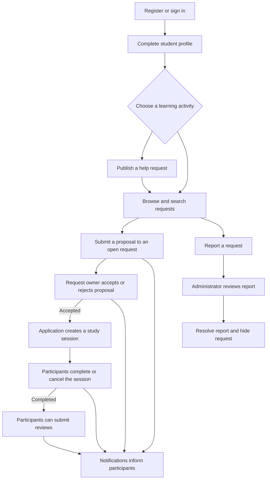
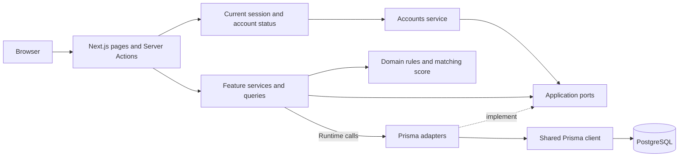

# CampusConnect

CampusConnect is a student-to-student learning support application. Students can publish academic help requests, discover requests from peers, offer help, and follow the resulting study sessions. The project combines a Next.js web application with a PostgreSQL-backed data model and a transparent, rule-based matching feature.

> **Project status:** This README describes the implementation currently present in this repository. Where the interface or data model has limitations, they are identified rather than presented as completed functionality.

## Table of contents

- [Problem statement](#problem-statement)
- [Objectives and intended users](#objectives-and-intended-users)
- [Features and roles](#features-and-roles)
- [Application workflow](#application-workflow)
- [Technology stack](#technology-stack)
- [Architecture](#architecture)
- [Project structure](#project-structure)
- [Important business rules and implementation notes](#important-business-rules-and-implementation-notes)
- [Getting started](#getting-started)
- [Docker setup](#docker-setup)
- [Testing and quality checks](#testing-and-quality-checks)

## Problem statement

Students often rely on informal channels to find help with coursework or to connect with classmates who can explain a topic. It can be difficult to discover who needs help, who is willing to provide it, and whether a study session has been arranged. CampusConnect provides a shared space for those peer-learning activities, with requests, proposals, sessions, reviews, and notifications represented in one application.

## Objectives and intended users

The project aims to:

- Make it straightforward for students to ask for or offer academic help.
- Organize requests by subject and academic level, with keyword search.
- Support a traceable request-to-proposal-to-session workflow.
- Provide profile information and compatibility recommendations to support peer discovery.
- Give administrators basic account and report-moderation controls.

The primary users are **students** looking for peer support or offering their knowledge. **Administrators** oversee user account status and review reports. The application uses a role field to distinguish these users; new registrations default to the student role.

## Features and roles

| Role | Implemented capabilities |
|---|---|
| Student | Register and sign in; edit a profile; publish and browse help requests; search requests by keyword, subject, and level; submit a proposal to an open request; accept or reject proposals on a request they own; view and manage study sessions; submit reviews for completed sessions; report a request; view and mark notifications as read. |
| Administrator | View user and request counts; suspend or reactivate accounts; review pending reports and hide the reported request while resolving a report. |

Other implemented capabilities include:

- A student dashboard with request/proposal counts, upcoming sessions, average rating, and recent notifications.
- Profile fields for specialty, academic level, biography, and skills.
- A rule-based Smart Matching page that ranks active, profiled students for an open request and shows a percentage score and short explanation.
- Request visibility controls used by report moderation.

## Application workflow



In the current implementation, accepting a proposal creates a session automatically with a default date and meeting details; participants do not choose those details in the acceptance flow. See [Important business rules and implementation notes](#important-business-rules-and-implementation-notes).

## Technology stack

| Area | Technologies |
|---|---|
| Web application | Next.js App Router, React, TypeScript |
| Styling and icons | Tailwind CSS, Lucide React |
| Database and ORM | PostgreSQL, Prisma ORM |
| Authentication | Auth.js / NextAuth Credentials provider, JWT sessions, `bcryptjs` |
| Input validation | Zod (used to validate sign-in credentials) |
| Unit testing | Vitest |
| Browser testing | Playwright |
| Containerization | Docker, Docker Compose, PostgreSQL 16 Alpine image |

Versions and scripts are defined in [`package.json`](./package.json), and the PostgreSQL container image is specified in [`docker-compose.yml`](./docker-compose.yml).

## Architecture

CampusConnect is a modular monolith. Next.js serves the interface and Auth.js sessions, and each feature owns its application contracts and Prisma adapter. All modules use the same PostgreSQL database. The server composition root in [`services.ts`](./src/presentation/server/services.ts) wires adapters and use cases together.



| Module | Responsibility |
| --- | --- |
| `accounts` | Registration, credentials, current account, and profile |
| `requests` | Publish and browse requests, and show the owner their proposals |
| `proposals` | Submit, accept, and reject offers of help |
| `sessions` | Manage study sessions and participant reviews |
| `moderation` | Reports and account status changes |
| `matching` | Candidate selection and compatibility scores |
| `notifications` | Read notifications and update read status |
| `dashboard` | Read the overview across several features |

### How a feature runs

1. A page or Server Action reads the current session. The [session helper](./src/presentation/server/access.ts) verifies the JWT identity against the current account status and role. Admin routes and actions also check the role.
2. The route calls the feature through the composition root. Application code enforces business rules and depends on typed ports. Domain code contains rules that can run without Next.js or Prisma.
3. The feature adapter owns the Prisma queries and transaction boundaries. For example, proposal submission saves the proposal and the owner's notification in the same transaction. Accepting an offer coordinates the proposal, request, session, and notifications in the proposal adapter.

When adding a feature, put its data contracts in `application/ports.ts`, rules and orchestration in `application/` or `domain/`, and Prisma operations in `infrastructure/`. The dashboard and notifications modules expose their ports through the composition root directly because their current operations are straightforward reads and updates.

## Project structure

```text
.
├── prisma/                         # Schema and committed migrations
├── src/
│   ├── app/                        # Routes, forms, and Server Actions
│   ├── components/layout/          # Shared shell and navigation
│   ├── domain/                     # Shared domain error
│   ├── infrastructure/persistence/ # Shared Prisma client and development seed
│   ├── modules/
│   │   ├── accounts/
│   │   ├── dashboard/
│   │   ├── matching/               # Includes the compatibility calculator
│   │   ├── moderation/
│   │   ├── notifications/
│   │   ├── proposals/              # Includes proposal domain rules
│   │   ├── requests/
│   │   └── sessions/
│   ├── presentation/
│   │   ├── auth.ts                 # Auth.js configuration
│   │   └── server/                 # Session checks and service composition
│   └── types/                      # Auth.js type augmentation
├── tests/
│   ├── e2e/                        # Browser smoke tests
│   └── unit/                       # Proposal rules and use cases
├── docker-compose.yml
├── Dockerfile
└── package.json
```

### Entity summary

| Entity | Purpose |
|---|---|
| `User` | Identity, unique email, password hash, role, and account status. |
| `StudentProfile` | Optional one-to-one profile with specialty, level, biography, skills, availability records, and cached rating statistics. |
| `Skill` | Reusable skill label connected to student profiles. |
| `Availability` | Day and time range associated with a student profile. |
| `Subject` | Reusable subject category for help requests. |
| `HelpRequest` | A student's request for academic support, with status and a moderation visibility flag. |
| `HelpProposal` | A student's response to a request; a request/student pair is unique. |
| `StudySession` | Session associated with a request, its owner, and the helping student. |
| `Review` | Rating and comment from one session participant about the other. |
| `Report` | Moderation report, optionally associated with a request, with reason and resolution status. |
| `Notification` | Per-user activity message with a read flag. |

`Report.proposalId` is currently a scalar field; the Prisma schema does not declare a relation or foreign key from it to `HelpProposal`. The user and request relations shown above are the relations explicitly declared in the schema.

## Important business rules and implementation notes

- New accounts are students with `ACTIVE` status. Registration requires a name of at least two characters and a password of at least six characters; email is stored in lowercase.
- Only active users can authenticate through the credentials flow.
- A student cannot propose help on their own request. Proposals can be submitted only while a request is `OPEN`.
- The request owner alone can accept or reject a proposal, and only pending proposals can be acted on. The database enforces at most one proposal for a given request/student pair, including after a proposal is rejected.
- Accepting a proposal is transactional: it accepts the chosen proposal, rejects other pending proposals for that request, changes the request to `HELP_ACCEPTED`, creates a study session, and creates notifications.
- The generated session currently defaults to one day after acceptance, 60 minutes, and online mode with a fixed meeting URL. The acceptance interface does not currently collect scheduling or meeting details.
- A participant may complete or cancel a scheduled session. Completing it also marks the associated request `COMPLETED`; cancellation changes the session status but does not reopen the request.
- Reviews are presented for completed sessions. A database uniqueness constraint prevents duplicate reviews for the same session/reviewer/reviewed-student combination. Submitting a review updates the reviewed student's aggregate rating and review count.
- Administrators can suspend or reactivate accounts. The application checks account status at sign-in and on protected pages and actions. The project does not implement email verification or password reset.
- Resolving a pending request report hides the associated request and marks the report resolved in a transaction.
- The Smart Matching calculator combines skill overlap (40%), specialty (20%), level (15%), availability (15%), and rating (10%). However, the current matching page passes an empty list of required skills, so the skill-overlap contribution is zero in that screen. Availability overlap is based on exact string comparison, while request availability is free text.

## Getting started

### Prerequisites

- Node.js 22 (the version used by the project Dockerfile) and npm.
- PostgreSQL 16 or a compatible PostgreSQL server, unless using Docker Compose.
- Git.

### Local development

1. Clone the repository and enter the project directory.
2. Create a local environment file:

   ```bash
   cp .env.example .env
   ```

3. Edit `.env` and set `DATABASE_URL` to a reachable PostgreSQL database. Set strong, unique values for `AUTH_SECRET` and `NEXTAUTH_SECRET`; set `NEXTAUTH_URL` to the local application URL.
4. Install dependencies:

   ```bash
   npm ci
   ```

5. Apply the committed database migrations:

   ```bash
   npx prisma migrate deploy
   ```

6. (Optional) Create development sample records:

   ```bash
   npm run db:seed
   ```

   **Warning:** the seed script deletes existing application records before inserting its sample data. Do not run it against a database containing data you need.

7. Start the development server and open [http://localhost:3000](http://localhost:3000):

   ```bash
   npm run dev
   ```

For schema development, `npm run db:migrate` runs `prisma migrate dev`. `npm run db:generate` regenerates the Prisma client after schema changes. The seed script and sample accounts are for local development only.

### Environment variables

| Variable | Purpose |
|---|---|
| `DATABASE_URL` | PostgreSQL connection string used by Prisma. |
| `AUTH_SECRET` | Secret used by Auth.js to protect authentication state. |
| `NEXTAUTH_SECRET` | Authentication secret also included in the environment template and Docker Compose configuration. |
| `NEXTAUTH_URL` | Canonical application URL; local development uses `http://localhost:3000`. |

Use the placeholder values in [`.env.example`](./.env.example) only as a template. Never commit real credentials or use development secrets in a deployed environment.

## Docker setup

The existing [`docker-compose.yml`](./docker-compose.yml) starts both PostgreSQL and the web application. PostgreSQL uses a persistent named volume, and the app waits for the database health check before starting. The container command applies committed Prisma migrations before serving the app.

1. Copy the environment template and replace the authentication secret values with strong local secrets:

   ```bash
   cp .env.example .env
   ```

   Compose supplies development defaults for PostgreSQL settings when they are not set. Override `POSTGRES_USER`, `POSTGRES_PASSWORD`, and `POSTGRES_DB` in `.env` if desired; the application container receives a database URL using the Compose service hostname.

2. Build and start the services:

   ```bash
   docker compose up --build
   ```

3. Open [http://localhost:3000](http://localhost:3000). PostgreSQL is exposed on port `5432`.
4. Stop the services with `Ctrl+C`, or run:

   ```bash
   docker compose down
   ```

The database volume remains after `docker compose down`. Adding `-v` removes the persisted database data. The Compose defaults are for local development only; replace them before any non-local deployment.

To run only PostgreSQL in Docker and run Next.js on the host, start the database with `docker compose up -d postgres`, then configure the host-side `DATABASE_URL` in `.env` and follow the local development steps above.

## Testing and quality checks

Run the checks defined in [`package.json`](./package.json):

```bash
npm run typecheck
npm run lint
npm test
```

The Vitest suite covers proposal business rules and the matching calculator. Playwright smoke tests cover the public landing page, sign-in navigation, and mobile viewport overflow:

```bash
npx playwright install chromium
npm run test:e2e
```

The Playwright configuration starts the Next.js development server when needed. A production build can be checked with:

```bash
npm run build
```
